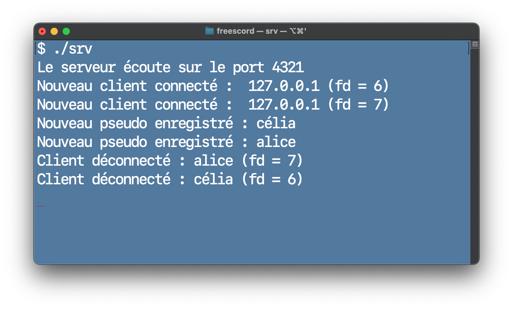
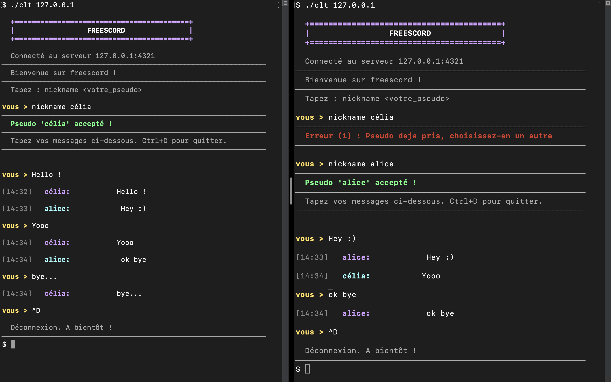

# Freescord

[🇬🇧 English version](README-en.md)

Freescord est un projet académique de messagerie instantanée développé en **C**, basé sur une architecture **client-serveur TCP**.

Le serveur accepte plusieurs clients en parallèle, vérifie les pseudonymes et diffuse les messages à l’ensemble des utilisateurs connectés.

## Fonctionnalités

- Communication réseau avec des sockets **TCP/IPv4**
- Gestion de plusieurs clients en parallèle avec des **threads POSIX**
- Diffusion des messages à l’aide d’un **pipe**
- Validation et unicité des pseudonymes
- Interface en terminal

## Compilation

### Prérequis

- GCC
- Un système POSIX (**Linux/macOS**)
- `pthread`

Pour compiler le projet :

```bash
make
```

Cette commande génère :

- `srv` : le serveur
- `clt` : le client

## Utilisation

### 1. Démarrer le serveur

Dans un premier terminal :

```bash
./srv
```

Le serveur écoute sur le port `4321`.

### 2. Lancer un client

Dans un autre terminal :

```bash
./clt 127.0.0.1
```

Choisir ensuite un pseudonyme :

```text
nickname alice
```

Les messages sont alors diffusés sous la forme :

```text
alice: Bonjour !
```

Pour tester la communication entre plusieurs utilisateurs, lancer `./clt 127.0.0.1` dans plusieurs terminaux.

## Captures d'écran

### Lancement du serveur



### Conversation entre plusieurs clients



## Structure principale

- `serveur.c` : code du serveur ;
- `client.c` : code du client ;
- `buffer/` : gestion des buffers réseau ;
- `list/` : liste chaînée des utilisateurs ;
- `user.c` / `user.h` : gestion des utilisateurs ;
- `client_display.c` / `client_display.h` : affichage côté client ;
- `Makefile` : compilation du projet.

## Contexte académique

Projet réalisé dans le cadre du module **Système d'exploitation**, en **L2 Informatique** (2025-2026).