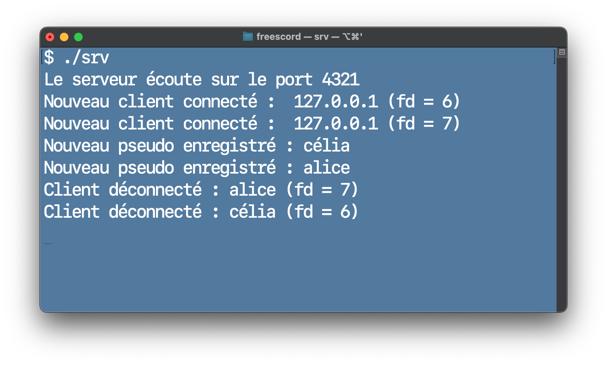
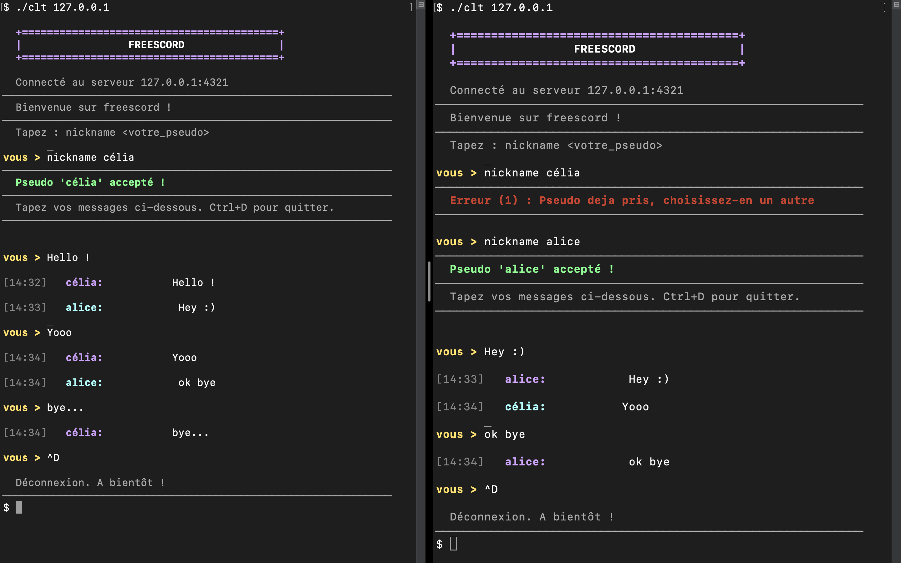

# Freescord

[🇫🇷 Version française](README-fr.md)

Freescord is an academic instant messaging project developed in **C**, based on a **TCP client-server architecture**.

The server supports multiple clients concurrently, validates usernames, and broadcasts messages to all connected users.

## Features

* Network communication using **TCP/IPv4 sockets**
* Concurrent management of multiple clients using **POSIX threads**
* Message broadcasting using a **pipe**
* Username validation and uniqueness
* Terminal-based interface

## Compilation

### Requirements

* GCC
* A POSIX system (**Linux/macOS**)
* `pthread`

To compile the project:

```bash
make
```

This command generates:

* `srv`: the server
* `clt`: the client

## Usage

### 1. Start the server

In a first terminal:

```bash
./srv
```

The server listens on port `4321`.

### 2. Start a client

In another terminal:

```bash
./clt 127.0.0.1
```

Then choose a username:

```text
nickname alice
```

Messages are then broadcast in the following format:

```text
alice: Hello!
```

To test communication between multiple users, run `./clt 127.0.0.1` in several terminals.

## Screenshots

### Server startup



### Conversation between multiple clients



## Project Structure

* `serveur.c`: server implementation
* `client.c`: client implementation
* `buffer/`: network buffer management
* `list/`: linked list for connected users
* `user.c` / `user.h`: user management
* `client_display.c` / `client_display.h`: client-side display
* `Makefile`: project compilation

## Academic Context

Project developed as part of the **Operating Systems** course during the **second year of the Bachelor's degree in Computer Science (L2)**, in the **2025–2026 academic year**.
